# EatBTI | 잇비티아이

> **혼밥도 나답게, 성향으로 찾는 나만의 맛집**

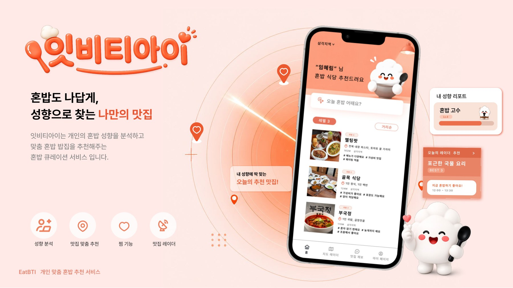

**EatBTI**는 개인의 혼밥 성향을 분석하고, 성향과 혼밥 레벨에 맞는 식당을 추천하는 **개인 맞춤 혼밥 큐레이션 서비스**입니다.

5가지 질문으로 나의 혼밥 성향을 확인하고, 원하는 지하철역 주변의 혼밥 맛집을 레이더 지도로 탐색합니다. 마음에 드는 식당은 단골가게로 저장하고, 태그로 식당의 특징을 공유할 수 있습니다.

## 목차

- [프로젝트 배경](#프로젝트-배경)
- [사용자 문제와 인사이트](#사용자-문제와-인사이트)
- [타깃 사용자](#타깃-사용자)
- [주요 기능](#주요-기능)
- [서비스 이용 흐름](#서비스-이용-흐름)
- [서비스 설계 방향](#서비스-설계-방향)
- [팀 구성](#팀-구성)

## 프로젝트 배경

### 혼밥 식당을 찾는 시간을 줄이고, 나를 위한 식사 시간을 늘릴 수는 없을까요?

1인 가구 증가와 개인화된 생활방식의 확산을 배경으로, 혼자 식사하는 문화가 일상화되고 있다는 점에 주목합니다.

하지만 혼밥할 식당을 고를 때 필요한 정보는 일반적인 맛집 정보와 다릅니다. 메뉴와 가격, 평점을 알아도 **혼자 들어가도 편안한지, 1인석이 있는지, 실제 혼밥 환경이 어떤지**는 쉽게 알기 어렵습니다.

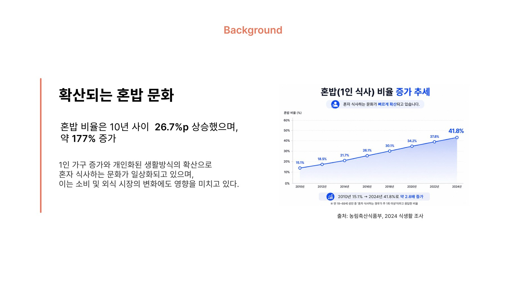

## 사용자 문제와 인사이트

### 사용자 인터뷰

- 여러 명이 방문한 후기가 많아 혼밥하기 편한 곳인지 판단하기 어렵습니다.
- 맛있다는 정보는 많지만 혼밥 환경에 관한 정보는 부족합니다.
- 혼자 방문하기 괜찮은 분위기인지는 직접 가봐야 알 수 있습니다.

> “혼자 들어가도 괜찮은 분위기인지 모르겠어요.”

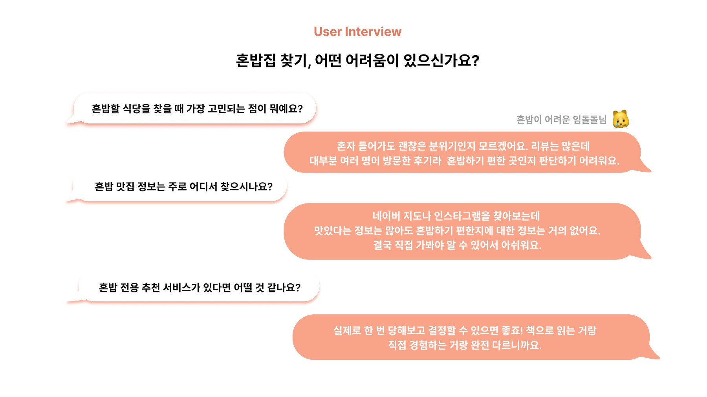

### 핵심 페인포인트

| 문제 | 사용자가 겪는 어려움 |
| --- | --- |
| 혼밥 가능 여부를 알기 어려움 | 혼자 방문해도 괜찮은 분위기인지 판단하기 어려움 |
| 혼밥 환경 정보 부족 | 방문 전에 좌석 구조와 혼밥 환경을 확인하기 어려움 |
| 심리적 부담 | 다른 사람의 시선을 의식해 식당에 들어가기를 망설임 |

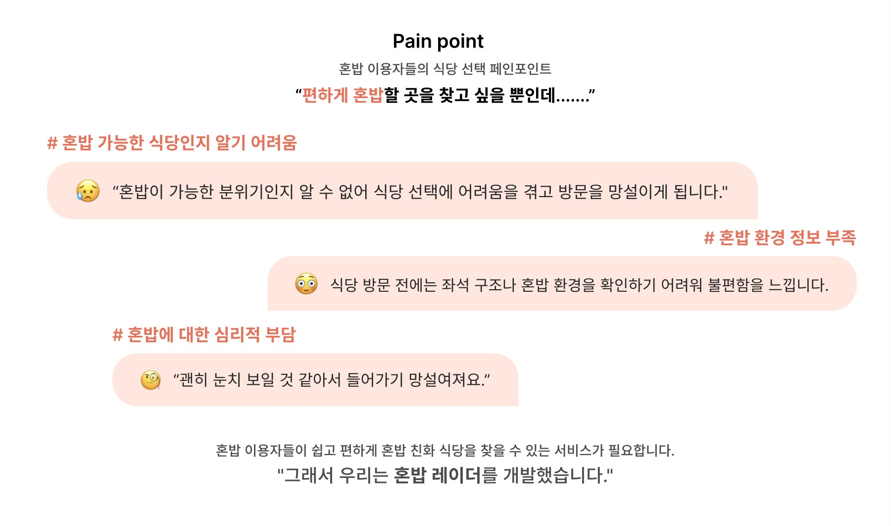

### 리서치 인사이트

**사용자에게 필요한 것은 단순한 맛집 정보가 아니라, 혼밥하기 좋은 환경에 대한 정보입니다.**

EatBTI는 개인의 혼밥 성향과 난이도를 고려한 추천, 지도 기반 탐색, 사용자 태그를 통해 식당 선택을 돕는 방향을 제안합니다.

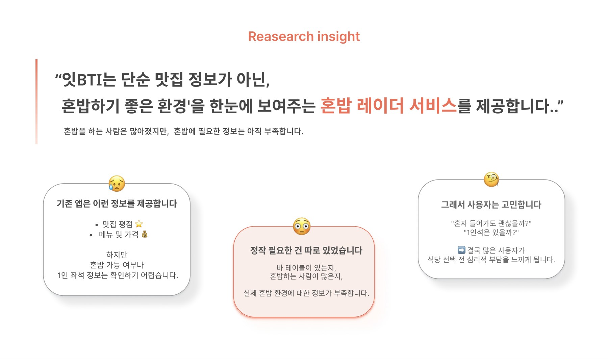

## 타깃 사용자

필드 리서치 응답을 바탕으로 두 가지 대표 페르소나를 제시합니다.

| 구분 | 혼밥 초보 임돌돌 | 혼밥 만렙 송민지 |
| --- | --- | --- |
| 특징 | 혼자 밥 먹는 것이 아직 어색함 | 혼밥은 가능하지만 새로운 식당은 망설여짐 |
| 주요 고민 | 혼자 식당에 들어가는 부담과 주변 시선 | 새로운 혼밥 맛집을 선택하는 어려움 |
| 필요한 정보 | 다른 사람의 후기, 혼밥하기 편한 좌석 | 취향에 맞는 식당, 새로운 맛집 |
| 원하는 경험 | 부담 없이 시작하는 혼밥 | 혼자만의 시간을 즐기는 식사 |

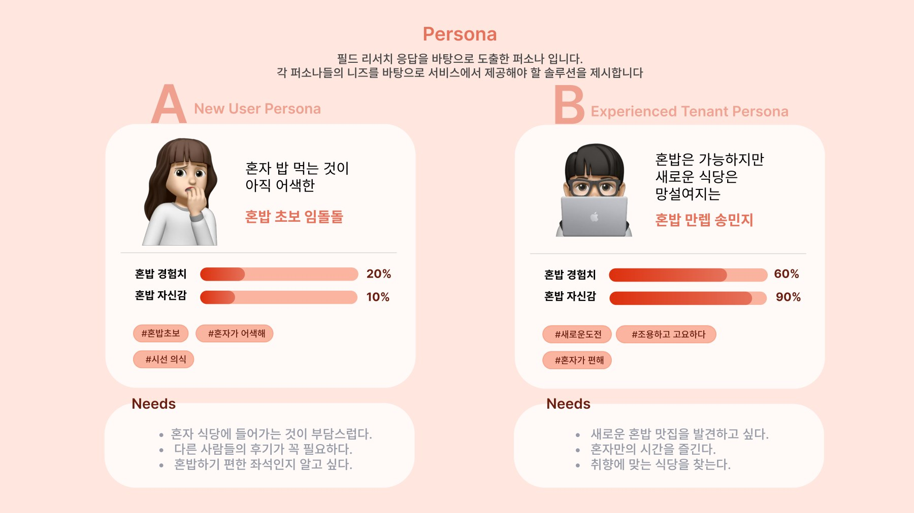

## 주요 기능

### 1. 잇BTI 검사 — 나의 혼밥 성향 알아보기

**5가지 질문**에 응답하면 혼밥 성향을 확인하고, 그에 맞는 인사이트를 받아볼 수 있습니다.

사용자 응답 패턴을 분석하는 성향 분석 알고리즘을 통해 혼밥 성향을 **5단계**로 분류하는 방식으로 설명합니다.

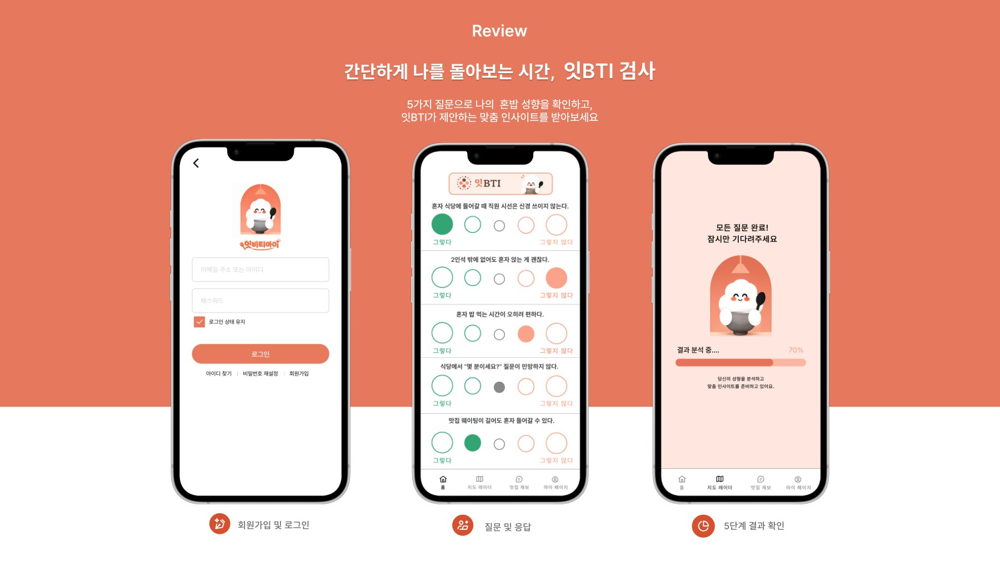

### 2. 혼밥 레벨 결과 — 나에게 맞는 추천의 시작

| 레벨 | 유형 |
| --- | --- |
| Level 1 | 초보자 |
| Level 2 | 혼밥 익숙해지는 중 |
| Level 3 | 혼밥 즐기는 편 |
| Level 4 | 혼밥 고수 |
| Level 5 | 혼밥 마스터 |

사용자는 결과 페이지에서 자신의 혼밥 상태와 특징을 확인하고, 레벨에 맞는 맛집 추천으로 이동할 수 있습니다.

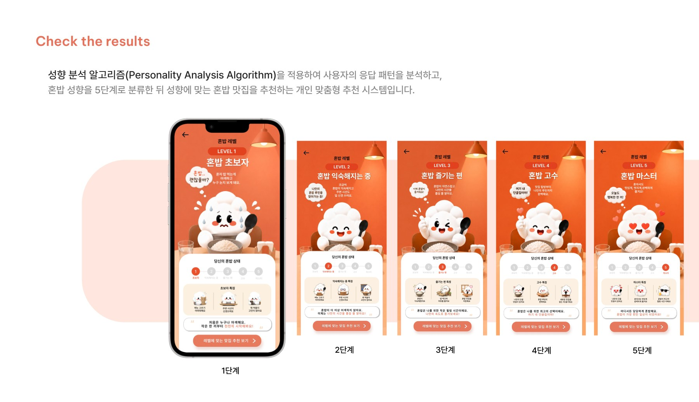

### 3. 메인 화면 — 레벨과 위치에 맞는 맛집 추천

잇BTI 검사 결과에 따라 혼밥 레벨별 식당을 추천합니다. 사용자가 설정한 **지하철역을 기준으로 주변 식당을 거리순으로 탐색**할 수 있습니다.

- 주변 탐색 기준이 되는 지하철역 설정
- 혼밥 레벨에 맞는 식당 추천
- 메뉴, 거리, 식당 특징 태그 확인
- 지도 레이더로 이동

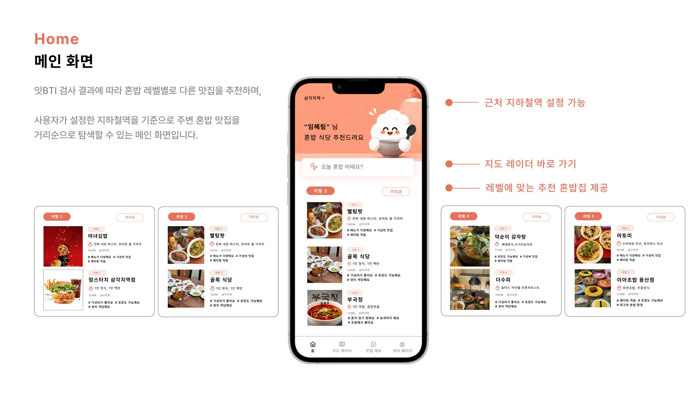

### 4. 혼밥 레이더 지도 — 원하는 역 주변을 한눈에

원하는 역을 기준으로 주변 맛집을 탐색하고, 혼밥 난이도와 개인 성향에 맞는 레벨별 식당을 확인합니다.

레이더 범위 안의 식당을 시각적으로 보여주어, 혼자 방문하기 편한 장소를 쉽고 빠르게 찾을 수 있도록 설계했습니다.

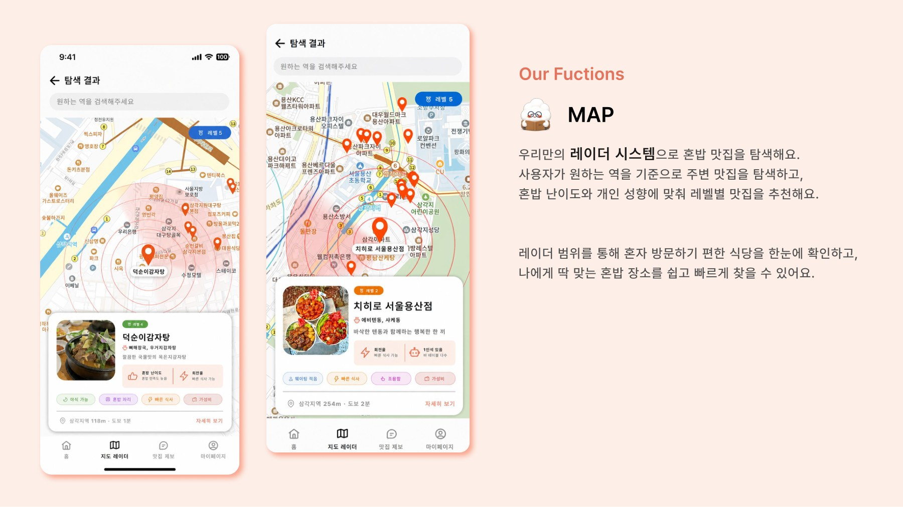

### 5. 단골가게·리뷰 태그 — 나의 경험을 저장하고 공유

마음에 드는 식당에서 **‘이런 곳 좋아요!’**를 누르면 단골가게에 저장됩니다. 식당의 특징을 나타내는 태그를 추가해 다른 사용자와 정보를 공유할 수 있습니다.

태그 예시:

- 혼자 앉기 편해요
- 가성비가 좋아요
- 식탁 간격이 넓어요

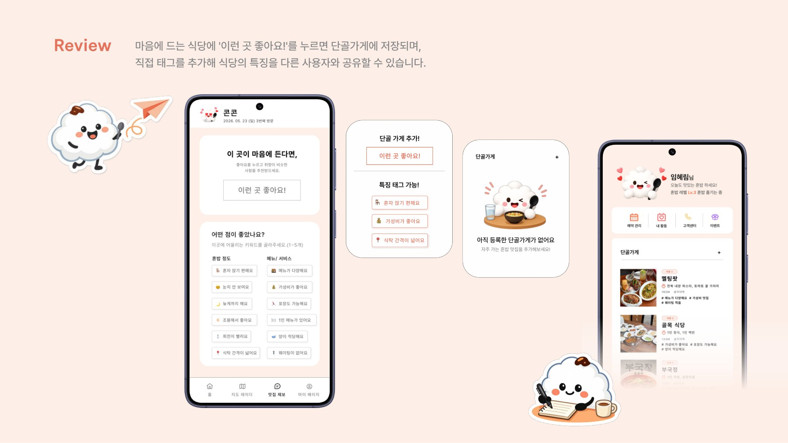

## 서비스 이용 흐름

1. **성향 검사:** 5가지 질문에 답해 자신의 혼밥 성향을 확인합니다.
2. **레벨 확인:** 5단계 중 자신의 혼밥 레벨과 특징을 확인합니다.
3. **탐색 위치 설정:** 원하는 지하철역을 선택합니다.
4. **맞춤 식당 탐색:** 레벨별 추천 목록과 레이더 지도에서 식당을 찾습니다.
5. **단골가게 저장:** 마음에 드는 식당을 저장합니다.
6. **경험 공유:** 식당의 혼밥 환경을 특징 태그로 공유합니다.

## 서비스 설계 방향

### 맛집 평점에서 ‘나에게 편한 혼밥 환경’으로

EatBTI는 다음 요소를 연결하는 데 초점을 맞춥니다.

- **성향 기반 추천:** 사용자의 혼밥 성향과 레벨에 맞춘 식당 제안
- **역 중심 탐색:** 사용자가 원하는 지하철역 주변의 식당 탐색
- **레이더 시각화:** 주변 혼밥 식당을 지도에서 직관적으로 확인
- **경험 정보 축적:** 단골가게 저장과 태그를 통한 식당 특징 공유

네이버 지도의 역 중심 탐색 방식과 성향 분석 결과를 시각화하는 페이지 구성을 벤치마킹 사례로 소개합니다.

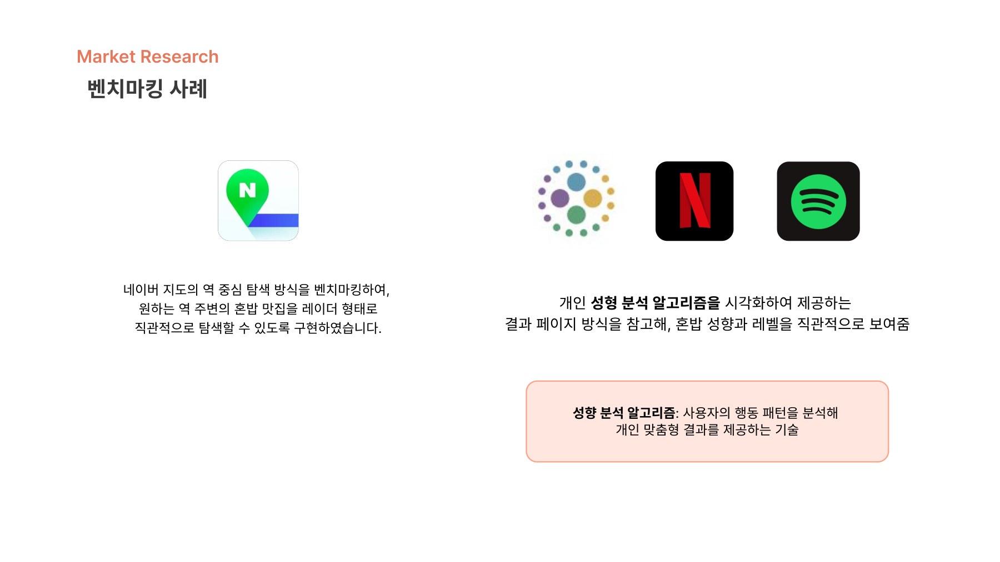

## 팀 구성

| 역할 | 이름 |
| --- | --- |
| Front-end | 임수연, 전채연 |
| Back-end | 김재혁, 임가영 |
| Design | 임혜림 |
